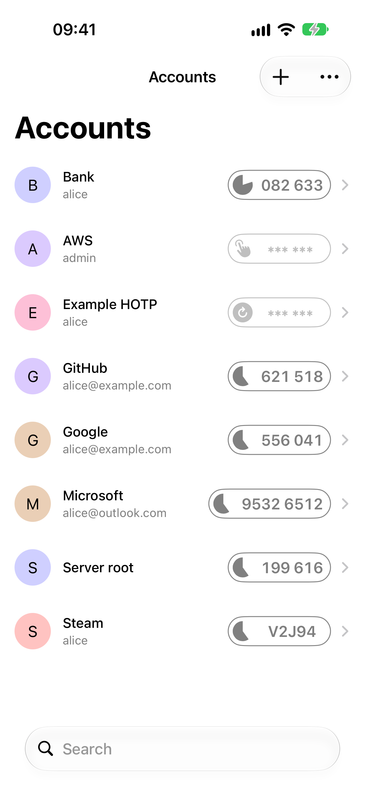
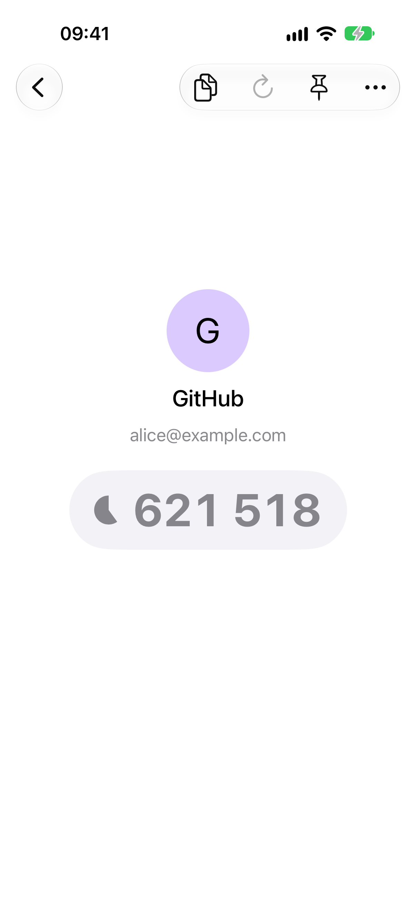
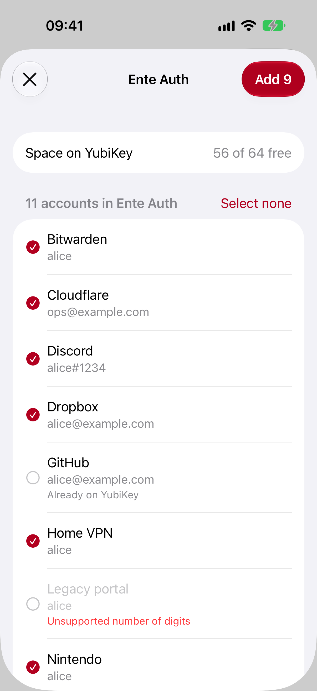
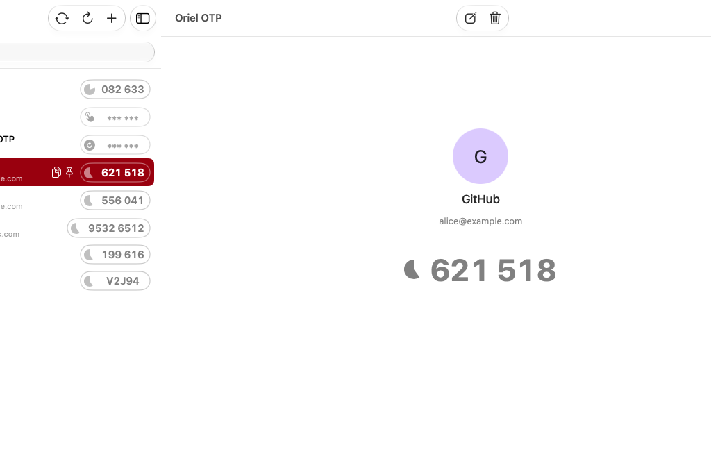
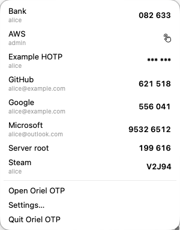
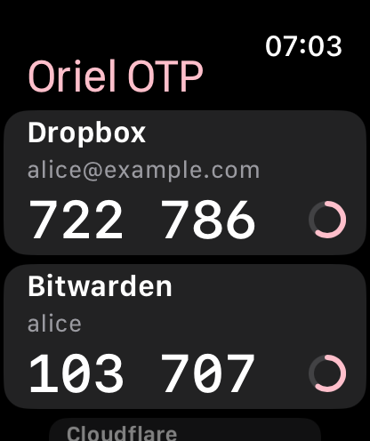
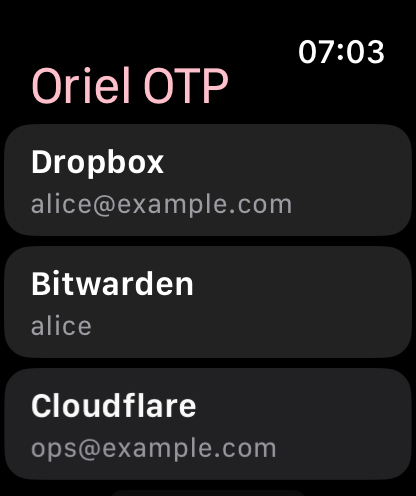
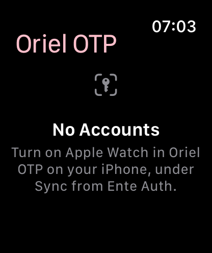

# Oriel OTP

Oriel OTP is an authenticator for iPhone, iPad and Mac that keeps your one-time password accounts on a YubiKey instead of
on your phone. It can also **import your accounts from [Ente Auth](https://ente.io/auth)**, so moving them onto a
hardware key takes a few taps instead of re-scanning every QR code.

  
  &nbsp;
  
  &nbsp;
  

On the Mac, the accounts sit in a sidebar, every action is in the menu bar, and the menu bar icon copies a code with
one click:

  
  &nbsp;
  

The screenshots are taken from the app in the simulator and on a Mac, with made-up demo accounts. See
[docs/screenshots.md](docs/screenshots.md).

## Features

- **OATH codes on a YubiKey.** Time-based (TOTP) and counter-based (HOTP) codes, as used by most online services.
  The secrets are stored on the YubiKey and the codes are calculated there; the app doesn't keep a copy.
- **Ente Auth import.** Sign in to Ente Auth, pick accounts and add them to the YubiKey. Accounts already on the
  key are skipped, and accounts the key can't store are listed with the reason.
  New accounts can be saved in Ente Auth as well when they are added to the YubiKey.
- **Ente Auth codes without a YubiKey.** Signed in, your Ente Auth accounts are listed with the YubiKey's and their
  codes calculated by the app, also offline. Accounts added, renamed, pinned or deleted in the app are synced back
  to Ente Auth, and changes from Ente's other apps show up here.
- **Adding accounts.** Scan a QR code or enter the details by hand. Accounts can require a touch of the YubiKey
  before a code is shown.
- **Everyday use.** Search, pin favorites, tap a code to copy it, rename and delete accounts, Steam codes, and an optional
  password for the YubiKey's OATH application.
- **App lock.** Optionally lock the app with Face ID or Touch ID, a 4 or 6 digit code, or a password.
- **Apple Watch.** Optionally shows the codes of your Ente Auth accounts on Apple Watch, without the iPhone nearby.
- **CryptoTokenKit.** Certificates in the YubiKey's PIV (smart card) application can be used to sign in to apps
  and websites through iOS, in the same way as other smart cards. macOS does this itself, without the app.
- **On the Mac.** Menu bar commands and keyboard shortcuts, a Settings window, codes in the menu bar, QR codes read
  from the screen, a pasted or dropped image or your iPhone's camera, a Copy Code action for Shortcuts, and a
  notification when the YubiKey needs a touch.

## Compatibility

| | |
| --- | --- |
| System | iOS and iPadOS 17 or later, on iPhone and iPad, and macOS 14 or later |
| Apple Watch | watchOS 10 or later, paired with an iPhone. Shows Ente Auth codes only; a watch can't reach a YubiKey |
| YubiKey | A YubiKey with the OATH application, such as the YubiKey 5 Series. The Security Key Series and YubiKey Bio don't have it. |
| NFC | On iPhone, by holding an NFC YubiKey (e.g. YubiKey 5 NFC) to the top of the phone |
| USB-C | On iPhones and iPads with a USB-C port, e.g. with a YubiKey 5C NFC |
| Lightning | Not supported. iPhones with a Lightning port use NFC; iPads with a Lightning port can't reach a YubiKey |
| Mac | Over USB only, with a USB-C or USB-A YubiKey, directly or through a hub or adapter |

## Ente Auth

Open the menu in the account list and choose **Sync from Ente Auth**, or tap the same button shown when the list is
empty. Pick the accounts and tap **Add**. A YubiKey holds a fixed number of accounts, so the sheet shows how much
room is left, only selects as many accounts as fit, and warns when the selection is too big.

The import reads accounts from Ente Auth and copies them onto the YubiKey. Accounts you later remove from Ente stay
on the YubiKey until you delete them there.

The other way, choose **YubiKey and Ente Auth** under **Save to** when adding an account to save it in Ente Auth too.
This needs a saved session (**Stay signed in**). A YubiKey never gives its secrets back, so this works only while an
account is added; accounts already on the key can't be copied to Ente.

With a saved session the app is also an Ente Auth client of its own. Your Ente Auth accounts are kept on the device,
encrypted, and listed with the YubiKey's, with a cloud next to each one, so their codes work without a YubiKey and
offline. When adding an account, choose under **Save to** whether it goes on the YubiKey, in Ente Auth or both; the
choice is remembered. Without a YubiKey to reach, the add button saves to Ente Auth. **Copy to YubiKey** and **Move to
YubiKey** on an Ente Auth account put it on the YubiKey; moving puts it in Ente's trash once it is on the key.
Renaming, pinning or deleting an Ente Auth account changes it in Ente Auth too (deleting moves it to Ente's trash),
and changes made in Ente's other apps show up after the next sync. The app syncs when it opens, when you pull down
the list (or choose Refresh on the Mac) and after each change. If the same account was changed on another device in
the meantime, the other device's change wins.

Everything is decrypted on the device and your Ente password never leaves it. Like Ente's own apps, the account
stays signed in: the session and the key that decrypts your accounts are kept in the keychain behind Face ID or
Touch ID (Touch ID or your password on the Mac), so later syncs need no password. The settings show the account
and **Sign out**. Turn off **Stay signed in** to keep nothing once the sheet is closed. Self-hosted Ente servers are supported. [docs/ente-auth.md](docs/ente-auth.md) describes how
the sign in and decryption work.

## Apple Watch

  
  &nbsp;
  
  &nbsp;
  

The watch app shows codes for the time-based accounts in your Ente Auth vault (TOTP and Steam). It can't use a
YubiKey, since watchOS gives apps no NFC, USB or smart card access, and it can't add, edit or delete accounts.

To turn it on, stay signed in to Ente Auth on the iPhone (**Stay signed in**), then open **Sync from Ente Auth** and
turn on **Show Ente Auth accounts on Apple Watch**. The switch is off by default and only appears when a watch with
the app is paired. The accounts are sent to the watch right away and again each time you sync. Counter-based (HOTP)
accounts are skipped, as the watch couldn't keep the counter in step with Ente.

Unlike the YubiKey accounts, **this keeps a copy of the Ente secrets on the watch**, in its keychain, readable only
while the watch is unlocked and never synced to iCloud or included in backups. The watch calculates the codes itself, so it works without
the iPhone. Turning the switch off or signing out of Ente deletes the accounts from the watch. Codes are hidden when
you lower your wrist or the screen is in Always On, and there is no way to copy a code on the watch.

## Security and privacy

- The app has no analytics or advertising and doesn't send your data to the developer.
- OATH secrets live on the YubiKey. The app only writes them to the key when you add an account. Signed in to Ente
  Auth, the app keeps an encrypted copy of your Ente Auth accounts on the device, with a key that never leaves it.
- If you turn on Apple Watch, the watch keeps a copy of your time-based Ente Auth accounts. It's off by default.
- A YubiKey password is only saved in the keychain if you choose to. The Ente Auth session and authenticator key
  stay on the device in the keychain, protected by Face ID or Touch ID (Touch ID or the password on the Mac), unless
  you turn off **Stay signed in**. The Ente password is never stored.
- The app can be locked with Face ID or Touch ID, a 4 or 6 digit code, or a password, under **App lock** in
  the settings (**Configuration** on iPhone and iPad, **Settings > General** on the Mac). It's off by default. The
  lock is asked for when the app opens and when it comes back from the background, or on the Mac when the screen
  locks or the Mac sleeps. Only a salted PBKDF2 hash of the code or password is kept, in the keychain on this device.
- The only network connections are to Ente's server, or your own, while you use Ente Auth in the app: during an
  import, and when the app syncs your Ente Auth accounts while you stay signed in.

See the [privacy policy](PRIVACY.md) for the details.

## Development

The app is developed in Xcode. Open `OrielOTP.xcodeproj` and run the `OrielOTP` scheme. It depends on
the [YubiKit SDK](https://github.com/Yubico/yubikit-swift), and for Ente Auth import on
[swift-sodium](https://github.com/jedisct1/swift-sodium) (libsodium) and
[BigInt](https://github.com/attaswift/BigInt), all added with the Swift Package Manager.

Debug builds in the simulator connect to a simulated YubiKey with demo accounts and can sign in to a fake Ente
server at `https://demo.ente.test` with any email and the password `demo` (add `+mfa`, `+2fa` or `+nosrp` to the
email's name to be asked for the code `123456`, and `+passkey` to also be asked for a passkey). None of this is
compiled into release builds. [docs/screenshots.md](docs/screenshots.md) explains how the README screenshots are
regenerated, [docs/ci.md](docs/ci.md) what CI checks and
[docs/testflight.md](docs/testflight.md) how builds from `main` reach TestFlight.

## About this fork

Oriel OTP is a fork of [Yubico Authenticator for iOS](https://github.com/Yubico/yubioath-ios). It is not affiliated
with or endorsed by Yubico or Ente; see [NOTICE](NOTICE). [docs/FORK.md](docs/FORK.md) describes how the fork is
kept in step with upstream and what the rebranding changes.

## License

Oriel OTP is licensed under the Apache License 2.0. See [LICENSE](LICENSE) for the copyright and license
information, and [NOTICE](NOTICE) for attribution.

## Support

See [SUPPORT.md](SUPPORT.md) for help, and report problems in
[the issue tracker on GitHub](https://github.com/SINF-KEN/oriel-otp/issues).
